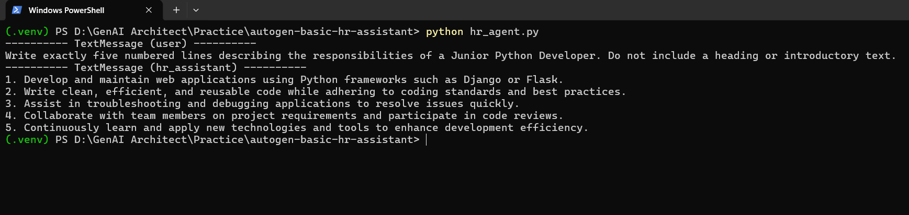

# AutoGen Basic HR Assistant

A simple HR assistant built with Microsoft's AutoGen framework and OpenAI. It generates a five-line job description for a Junior Python Developer.

## Technologies Used

- Python
- Microsoft AutoGen
- OpenAI API (`gpt-4o-mini`)

## Project Structure

```text
autogen-basic-hr-assistant/
├── screenshots/
│   └── demo.png
├── .env
├── .gitignore
├── hr_agent.py
├── README.md
└── requirements.txt
```

## Setup

### 1. Create and activate a virtual environment

```powershell
python -m venv .venv
.\.venv\Scripts\Activate.ps1
```

### 2. Install dependencies

```powershell
pip install -r requirements.txt
```

### 3. Configure the API key

Create a `.env` file in the project root:

```env
OPENAI_API_KEY=your_openai_api_key
```

Replace the placeholder with your actual API key.

### 4. Run the application

```powershell
python hr_agent.py
```

The assistant generates and displays a job description in the terminal.

## Demo

